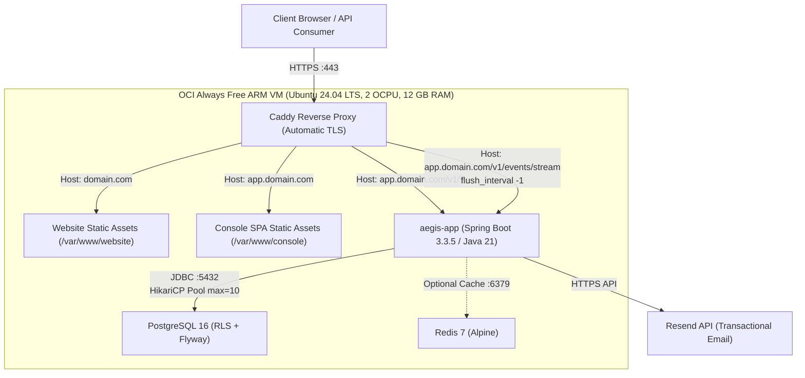

# Aegis: Free-Tier Production Hosting Guide

This guide details the complete production hosting setup for Project Aegis (marketing website, React console, Spring Boot monolith backend, and PostgreSQL database) using zero-cost infrastructure tiers.

---

## 1. Architecture Summary

### Recommended Architecture: Unified ARM Host (Option A)

The recommended production deployment deploys the entire stack onto a single **Oracle Cloud Infrastructure (OCI) Always Free Ampere A1 Compute VM** orchestrated by Docker Compose and reverse-proxied by Caddy.



### Why This Architecture?

1. **Deterministic Performance (No Cold Starts):** The decision engine advertises sub-10ms evaluation. Serverless container platforms (Render, Koyeb, Cloud Run) idle down after 15–60 minutes, incurring 1–5 second cold starts that break decision SLA. The OCI VM runs 24/7 continuously.
2. **Same-Origin Cookie Transmission:** All React console requests to `/v1/*` route through `app.domain.com/v1/*`. Because the frontend SPA and the backend API share the exact same host and port, requests are strictly same-origin. This eliminates CORS preflight overhead and prevents modern browsers from dropping `SameSite=Strict` cookies.
3. **SSE Streaming Stability:** Caddy directly handles TLS termination and disables response buffering (`flush_interval -1`), allowing Server-Sent Events (`/v1/events/stream`) to stream decision audits in real time without proxy timeout disconnections.
4. **Resource Headroom:** 12 GB RAM and 2 ARM vCPUs provide more than 8x the memory required by Aegis today (~1.2 GB total across OS, Postgres, Redis, and Spring Boot).

### Monthly Cost Breakdown

| Component | Provider & Tier | Monthly Cost |
| :--- | :--- | :--- |
| **Compute & Network** | OCI Always Free (Ampere A1: 2 OCPU, 12 GB RAM, 200 GB NVMe, 10 TB egress) | **$0.00** |
| **Database** | Self-hosted PostgreSQL 16 on OCI VM with local NVMe volume | **$0.00** |
| **Reverse Proxy & TLS** | Caddy v2 (Let's Encrypt / ZeroSSL auto-renewing ACME certificates) | **$0.00** |
| **Transactional Email** | Resend Free Plan (100 emails/day, 3,000 emails/month) | **$0.00** |
| **DNS & DDoS Protection** | Cloudflare Free Plan | **$0.00** |
| **Custom Apex Domain** | Registrar of choice (e.g. `.xyz`, `.site`, or `.in`) | **~$1.50 – $2.50 / year** (~$0.15/month) |
| **Total Monthly Spend** | | **~$0.15 – $0.20** |

---

## 2. What Is Free and What Is Not

*Verification Date: October 2026. Data sourced from official provider pricing and documentation.*

### Verified Free Tier Allowances

| Provider | Service | Free Tier Specifications & Limits | Hard Cutoffs & Expiration | Credit Card Required? | Commercial Use Allowed? |
| :--- | :--- | :--- | :--- | :--- | :--- |
| **Oracle Cloud** | Compute (Ampere A1) | Up to 4 OCPUs and 24 GB RAM (can be split, e.g. 2 OCPU / 12 GB RAM), 200 GB Block Storage, 10 TB/mo outbound egress. | Compute instances are permanent. Idle reclamation policy exists (alerts sent if CPU < 20% for 7 days; running JVM + Postgres keeps it active). | Yes (identity verification; small temporary hold refunded). | Yes. |
| **Cloudflare** | DNS & Pages | Unlimited DNS queries, DDoS mitigation, Pages static hosting with unlimited bandwidth and 500 builds/month. | 100 custom domains per account. Fair use limits apply. | No. | Yes. |
| **Resend** | Transactional Email | 100 emails/day, 3,000 emails/month, 1 custom domain with DKIM/SPF/DMARC. | Outbound emails fail with 429 when daily 100-email limit is hit. Never auto-bills. | No. | Yes. |
| **GitHub** | Actions (CI/CD) | 2,000 Action build minutes/month for private repos (unlimited for public). | Workflow runs pause when limit exceeded. | No. | Yes. |
| **UptimeRobot** | Health Monitoring | 50 monitors, 5-minute check intervals, HTTP status alerting. | Free accounts require periodic login once per year. | No. | Yes. |

### Fallback Providers Evaluated

| Provider | Service | Free Limitations & Disqualification Verdict |
| :--- | :--- | :--- |
| **Render** | Backend Compute & DB | Compute sleeps after 15 minutes of inactivity (~50-second cold start). **Critical:** Free PostgreSQL databases are deleted permanently after 30 days. Not viable. |
| **Koyeb** | Backend Compute | 512 MB RAM, 0.1 vCPU, 2 services maximum. Sleeps after 1 hour idle (1–5 second cold start). Viable only as lightweight fallback. |
| **Neon** | Serverless Postgres | 100 CU-hours/month, 1 GB storage. Auto-pauses compute after 5 minutes of inactivity (500ms–2s cold start on next query). Viable for low-traffic dev, risky for sub-10ms production SLA. |
| **Supabase** | Managed Postgres | 500 MB database, 50,000 monthly active users. Pauses project after 7 days of inactivity. |
| **Vercel** | Static & Edge | **Explicitly prohibits commercial and business activity on the Hobby free tier.** Disqualified for production business deployment. |

### The Unavoidable Realities (What Cannot Be 100% Free)

1. **Custom Domain Requirement (~$2.00 / year):**
   Free subdomains (such as `*.vercel.app`, `*.pages.dev`, `*.duckdns.org`) are registered on the **Public Suffix List (PSL)**. Browsers treat distinct subdomains under a PSL root as separate sites. This breaks cross-subdomain `SameSite=Strict` cookie transmission and prevents custom DNS DKIM/SPF verification required by email providers like Resend. A real custom apex domain (`yourdomain.xyz`) is an architectural prerequisite.
2. **Indian SMS OTP Telecom Mandates (TRAI DLT):**
   In India, commercial SMS delivery requires registration on a Distributed Ledger Technology (DLT) portal under TRAI regulations. Registration costs approximately **₹5,000 + 18% GST ($68 USD)** as a one-time fee, plus per-message transactional routing fees (~₹0.12–₹0.15/SMS). **No free SMS gateway exists in India.**
   *Production Resolution:* For zero-cost operation, Aegis must fall back to transactional email OTP via Resend for user signups, or require operators to register an Indian DLT account if SMS is mandatory.

---

## 3. Prerequisites & Accounts to Create

Create the following free accounts before deployment:

1. **Oracle Cloud Infrastructure (OCI):** Sign up for an [Oracle Cloud Free Tier](https://www.oracle.com/cloud/free/) account. Choose a Home Region geographically close to your target users (e.g. `ap-mumbai-1` or `ap-hyderabad-1` for India, `us-ashburn-1` for US East).
2. **Cloudflare:** Register a free account at [cloudflare.com](https://dash.cloudflare.com/sign-up) for DNS management.
3. **Resend:** Register a free account at [resend.com](https://resend.com/signup).
4. **Domain Registrar:** Purchase an inexpensive apex domain (e.g. from Namecheap, Porkbun, or Cloudflare Registrar).
5. **GitHub:** Ensure your Aegis repository is hosted on GitHub for automated CI/CD.

---

## 4. Domain & DNS Setup

Point your domain's nameservers to Cloudflare. In the Cloudflare DNS dashboard, create the following DNS records. Replace `YOUR_SERVER_IP` with your OCI instance public IPv4 address, and `aegis-engine.com` with your domain.

### Primary Routing Records

| Type | Name | Content / Target | Proxy Status | Purpose |
| :--- | :--- | :--- | :--- | :--- |
| **A** | `@` | `YOUR_SERVER_IP` | **DNS Only** (Grey Cloud) | Marketing Website (Astro) |
| **A** | `app` | `YOUR_SERVER_IP` | **DNS Only** (Grey Cloud) | Console SPA & API Gateway |

> [!IMPORTANT]
> Keep Cloudflare Proxy **disabled** (DNS Only / Grey Cloud) during initial setup. Caddy requires direct HTTP access on port 80 to obtain Let's Encrypt TLS certificates via ACME HTTP-01 challenges. You can enable Cloudflare proxying later only if you configure Caddy with the Cloudflare DNS ACME plugin or set Cloudflare SSL/TLS to "Full (Strict)".

### Resend Email Authentication Records

Add the DNS records provided in your Resend domain dashboard:

| Type | Name | Content / Value | Priority | Purpose |
| :--- | :--- | :--- | :--- | :--- |
| **TXT** | `resend._domainkey` | `p=MIGf...` *(Key generated by Resend)* | - | DKIM Signature |
| **MX** | `bounces` | `feedback-smtp.resend.com` | 10 | Return-Path MX |
| **TXT** | `bounces` | `v=spf1 include:amazonses.com ~all` | - | SPF Sender Verification |
| **TXT** | `_dmarc` | `v=DMARC1; p=none;` | - | DMARC Policy |

---

## 5. Server Provisioning & Database Setup

### 5.1 Provision the OCI VM
1. Log into OCI Console → **Compute** → **Instances** → **Create Instance**.
2. **Image:** Canonical Ubuntu 24.04 LTS (Minimal or Minimal aarch64).
3. **Shape:** Ampere VM.Standard.A1.Flex:
   - OCPUs: **2**
   - Memory: **12 GB**
4. **Networking:** Assign a Public IPv4 address.
5. **SSH Keys:** Upload your personal public SSH key.
6. Click **Create**.

### 5.2 Configure OCI Ingress Security Rules
In OCI Console → **Networking** → **Virtual Cloud Networks** → select your VCN → **Security Lists** → Default Security List:
Add Ingress Rules:
- `0.0.0.0/0`, TCP, Destination Port: `80` (HTTP)
- `0.0.0.0/0`, TCP, Destination Port: `443` (HTTPS)

### 5.3 Bootstrap Server Environment
SSH into the instance and run the Aegis bootstrap script:

```bash
ssh -i ~/.ssh/id_rsa ubuntu@YOUR_SERVER_IP
```

Download and execute [`infra/prod/bootstrap-server.sh`](file:///c:/dev/aegis/infra/prod/bootstrap-server.sh):

```bash
curl -fsSL https://raw.githubusercontent.com/YOUR_ORG/aegis/main/infra/prod/bootstrap-server.sh -o bootstrap.sh
chmod +x bootstrap.sh
sudo ./bootstrap.sh
```

This installs Docker Engine, Docker Compose, sets iptables firewall rules for ports 22, 80, and 443, and creates the `/opt/aegis` deployment directory.

### 5.4 Database Storage & Migration Behavior
PostgreSQL 16 runs inside Docker with its data directory mapped to a persistent named Docker volume (`postgres_data`).
- **Row-Level Security (RLS):** Aegis enforces multi-tenancy at the database level. Every decision query runs inside a transaction setting `SET LOCAL app.current_tenant_id = '...'`.
- **Flyway Migrations:** Migrations execute automatically upon Spring Boot startup using the credentials specified in `SPRING_DATASOURCE_USERNAME` and `SPRING_DATASOURCE_PASSWORD`.
- **Connection Pool:** In production, HikariCP is restricted to `maximum-pool-size: 10` and `minimum-idle: 2` in `application-prod.yml` to conserve database memory.

---

## 6. Backend Deployment

The backend is packaged as a lightweight, hardened container using Eclipse Temurin 21 Alpine JRE.

### Memory & JVM Configuration
Inside [`infra/docker/Dockerfile.backend`](file:///c:/dev/aegis/infra/docker/Dockerfile.backend):
```dockerfile
ENV JAVA_OPTS="-XX:InitialRAMPercentage=40.0 \
               -XX:MaxRAMPercentage=75.0 \
               -XX:+UseSerialGC \
               -XX:+ExitOnOutOfMemoryError \
               -Djava.security.egd=file:/dev/./urandom"
```
- `-XX:+UseSerialGC` minimizes GC thread memory overhead on containerized ARM workloads.
- The container is allocated a 768 MB RAM limit in Docker Compose. Spring Boot consumes ~320–420 MB RSS under active load.

### Build and Package Command
On the host or build runner:
```bash
./gradlew :backend:aegis-app:bootJar -x test
docker build -t aegis-app:latest -f infra/docker/Dockerfile.backend .
```

---

## 7. Console & Website Deployment

Both frontends compile to static HTML, CSS, and JS bundles served directly by Caddy.

### 7.1 Build the Marketing Website (Astro)
In `website/`:
```bash
npm --prefix website ci
npm --prefix website run build
```
Build output: `website/dist/`. This contains zero-JavaScript static HTML.

### 7.2 Build the Console SPA (React / Vite)
In `frontend/`:
```bash
npm --prefix frontend ci
npm --prefix frontend run build
```
Build output: `frontend/dist/`. Caddy serves this with client-side routing fallback (`try_files {path} /index.html`).

---

## 8. Wiring It Together: Caddy Reverse Proxy & Routing

Caddy coordinates all ingress traffic through [`infra/prod/Caddyfile`](file:///c:/dev/aegis/infra/prod/Caddyfile):

```caddy
# Marketing Website
{$DOMAIN:localhost} {
    root * /var/www/website
    file_server
    encode zstd gzip

    handle_errors {
        rewrite * /404.html
        file_server
    }
}

# Console SPA + API Gateway
app.{$DOMAIN:localhost} {
    encode zstd gzip

    # Decision API & Auth routes -> Spring Boot Monolith
    handle /v1/* {
        reverse_proxy app:8080 {
            header_up X-Forwarded-Proto {scheme}
            header_up X-Real-IP {remote_host}
        }
    }

    # Live Event Stream -> Unbuffered SSE
    handle /v1/events/stream {
        reverse_proxy app:8080 {
            header_up X-Forwarded-Proto {scheme}
            header_up X-Real-IP {remote_host}
            flush_interval -1
        }
    }

    # Console Frontend Single Page Application
    handle {
        root * /var/www/console
        file_server
        try_files {path} /index.html
    }
}
```

### Why This Solves Production Gotchas:
1. **Zero CORS:** The browser interacts with `app.domain.com/v1/decisions` directly. No preflight `OPTIONS` calls are required for standard requests.
2. **Cookies Just Work:** `jwt_refresh_token` set with `Path=/; HttpOnly; SameSite=Strict` is automatically sent with every request to `app.domain.com/v1/auth/refresh`.
3. **SSE Connection Lifespan:** `flush_interval -1` prevents Caddy from buffering chunked responses on `/v1/events/stream`.

---

## 9. First Production Run: Step-by-Step

### Step 1: Deploy Project Files to Server
On your production server:
```bash
cd /opt/aegis
# Clone or copy repository
git clone https://github.com/YOUR_ORG/aegis.git .
```

### Step 2: Configure Environment Variables
Copy the template and fill in production secrets:
```bash
cp .env.example .env
nano .env
```
Ensure the following variables are populated:
```ini
SPRING_PROFILES_ACTIVE=prod
DOMAIN=yourdomain.xyz
ACME_EMAIL=admin@yourdomain.xyz
SPRING_DATASOURCE_PASSWORD=GenerateAStrong32CharDbPassword
AEGIS_JWT_SECRET=GenerateA64CharRandomHexSecretForHs512Algorithm
AEGIS_NOTIFICATION_RESEND_API_KEY=re_your_resend_api_key_here
AEGIS_NOTIFICATION_FROM_EMAIL=no-reply@yourdomain.xyz
```

### Step 3: Build and Start Services
```bash
docker compose -f docker-compose.prod.yml up -d --build
```

### Step 4: Verify Container Health
```bash
docker compose -f docker-compose.prod.yml ps
```
All containers (`aegis-caddy`, `aegis-backend`, `aegis-postgres`, `aegis-redis`) should report `Up` or `healthy`.

### Step 5: Test Actuator Health Endpoint
```bash
curl -I https://app.yourdomain.xyz/v1/actuator/health
```
Expected output:
```http
HTTP/2 200 
content-type: application/vnd.spring-boot.actuator.v3+json
{"status":"UP"}
```

### Step 6: Initial Signup and Seed Verification
1. Navigate to `https://app.yourdomain.xyz/signup`.
2. Register the initial owner user.
3. Verify TOTP 2FA configuration in an authenticator app (e.g. Google Authenticator).
4. Send a test decision request via `curl`:
```bash
curl -X POST https://app.yourdomain.xyz/v1/decisions \
  -H "Content-Type: application/json" \
  -H "Authorization: Bearer YOUR_ACCESS_TOKEN" \
  -d '{
    "transaction_id": "tx_prod_001",
    "card_token": "tok_visa_4242",
    "amount_cents": 12500,
    "currency": "USD",
    "merchant_id": "merch_acme_01",
    "merchant_category_code": "5411",
    "country_code": "US"
  }'
```
5. Confirm decision response returns `APPROVE` or `REVIEW` in `< 10ms`.
6. Test website contact form at `https://yourdomain.xyz/contact` and verify email delivery in Resend.

---

## 10. Automated CI/CD (GitHub Actions)

Deployments are automated on push to `main` via [`.github/workflows/deploy.yml`](file:///c:/dev/aegis/.github/workflows/deploy.yml).

### Configure Repository Secrets
In your GitHub repository → **Settings** → **Secrets and variables** → **Actions**, add:
- `PROD_HOST`: Your server's public IPv4 address.
- `PROD_USER`: `ubuntu`
- `PROD_SSH_KEY`: The private SSH key matching the public key on the server.
- `PROD_DOMAIN`: Your apex domain (e.g. `yourdomain.xyz`).

The pipeline:
1. Validates backend tests and builds the executable JAR.
2. Builds static website and console artifacts.
3. Bundles artifacts and deploys via SSH to `/opt/aegis`.
4. Executes `docker compose up -d --build` with zero downtime.

---

## 11. Backups & Data Safety

To maintain zero-cost compliance without paid cloud backup plans, automate local and encrypted remote database dumps via cron.

### 11.1 Automated Backup Script
Create `/opt/aegis/scripts/backup-db.sh`:
```bash
#!/usr/bin/env bash
set -euo pipefail

BACKUP_DIR="/opt/aegis/backups"
TIMESTAMP=$(date +"%Y%m%d_%H%M%S")
FILENAME="aegis_db_${TIMESTAMP}.sql.gz"

mkdir -p "${BACKUP_DIR}"

# Execute pg_dump inside the running container
docker compose -f /opt/aegis/docker-compose.prod.yml exec -T postgres \
  pg_dump -U aegis_app aegis_db | gzip > "${BACKUP_DIR}/${FILENAME}"

# Prune local backups older than 7 days
find "${BACKUP_DIR}" -type f -name "aegis_db_*.sql.gz" -mtime +7 -delete

echo "[$(date)] Backup completed: ${BACKUP_DIR}/${FILENAME}"
```

Make it executable:
```bash
chmod +x /opt/aegis/scripts/backup-db.sh
```

### 11.2 Daily Cron Job
Add to root crontab (`sudo crontab -e`):
```cron
0 2 * * * /opt/aegis/scripts/backup-db.sh >> /var/log/aegis-backup.log 2>&1
```

*(Optional Free Offsite Backup: Install `rclone` and sync `/opt/aegis/backups` to a free Google Drive or Mega account with 15 GB storage).*

---

## 12. Monitoring & Uptime

To avoid violating free-tier terms of service while maintaining visibility:

1. **UptimeRobot Free Monitor:**
   - URL: `https://app.yourdomain.xyz/v1/actuator/health`
   - Monitoring Interval: **5 minutes** (well within UptimeRobot free tier limits).
   - Alerting: Email alert on 2 consecutive failures.
2. **OCI Compute Health Alarms:**
   - Set up an OCI Cloud Guard alarm notifying your email if VM status transitions to `STOPPED`.

---

## 13. Cost Guardrails

Oracle Cloud will never bill you for Always Free services if you do not upgrade to Paid tier. However, to guarantee you never incur accidental charges:

1. **Set Up an OCI Budget Alert:**
   - Go to OCI Console → **Billing & Cost Management** → **Budgets**.
   - Create a budget of **$1.00 USD**.
   - Set an alert threshold at **1% ($0.01 USD)** to be sent to your email immediately if any billable resource is provisioned.
2. **Never Attach Paid Public IPs:** Use only the Ephemeral or Reserved free IPv4 address provided with your instance.
3. **Stay Within Storage Limits:** Keep total boot volume size at or below **200 GB**.

---

## 14. Limits & When to Upgrade

This free-tier setup handles:
- **Decision Engine Throughput:** ~150–250 transactions per second (TPS) on 2 ARM vCPUs.
- **Database Storage:** ~200,000–500,000 transaction records before requiring database vacuum/archival.
- **Transactional Emails:** 100 emails/day (~3,000/month).

### Trigger Points for Paid Upgrades:
- **When transaction volume exceeds 100 OTPs/day:** Upgrade Resend to the $20/month plan.
- **When concurrent TPS exceeds 500:** Scale OCI VM to 4 OCPUs / 24 GB RAM (still free if within limits), or upgrade to dedicated Postgres on Neon/AWS RDS.
- **When formal compliance (SOC2 / PCI-DSS certification) is required:** Free tiers lack audited compliance guarantees; migrate to AWS/GCP with dedicated VPC peering.

---

## 15. Troubleshooting Production Issues

| Symptom | Probable Cause | Exact Fix |
| :--- | :--- | :--- |
| **`403 Forbidden` on `/v1/auth/refresh`** | Cookie `SameSite` or `Domain` mismatch. | Verify requests are routed through `app.domain.com/v1/*` (same origin). Ensure browser is accessing via HTTPS. |
| **SSE stream stops after 60 seconds** | Reverse proxy buffer timeout. | Verify Caddyfile contains `flush_interval -1` inside `handle /v1/events/stream`. |
| **Caddy fails to issue SSL certificate** | Port 80 blocked by firewall or Cloudflare proxy active. | Run `sudo ufw allow 80/tcp`. Ensure Cloudflare DNS records are set to "DNS Only" (Grey Cloud). |
| **Emails fail silently or bounce** | Resend domain DNS unverified. | Check Resend Dashboard. Verify DKIM `resend._domainkey` and SPF `bounces` records in Cloudflare. |
| **Database fails with connection refused** | Postgres container restarting due to OOM. | Run `docker compose -f docker-compose.prod.yml logs postgres`. Ensure HikariCP max pool size is $\le 10$. |

---

## 16. Rollback Procedures

If a deployment introduces a critical regression:

### Fast Image Rollback (Docker)
```bash
cd /opt/aegis
# Check previous image tags
docker images aegis-app

# Re-tag previous image and restart
docker tag aegis-app:previous aegis-app:latest
docker compose -f docker-compose.prod.yml up -d aegis-app
```

### Git Revert Rollback
```bash
git log -n 5 --oneline
git checkout HEAD~1
./gradlew :backend:aegis-app:bootJar -x test
docker compose -f docker-compose.prod.yml up -d --build
```

---

## Required Code Changes to Flag for Review

Before taking this setup live, the following two items in `AuthController.java` require human architectural approval:

1. **Hardcoded Secure Cookie Flag:**
   - In [`backend/aegis-identity/src/main/java/com/aegis/identity/controller/AuthController.java`](file:///c:/dev/aegis/backend/aegis-identity/src/main/java/com/aegis/identity/controller/AuthController.java):
     ```java
     .secure(false) // Hardcoded for local dev
     ```
   - *Fix:* Must be bound to `@Value("${aegis.auth.cookie.secure:true}")` so cookies are marked `Secure` in production over HTTPS.
2. **Indian SMS OTP vs Email Fallback:**
   - In `AuthController.java`, the signup flow attempts to dispatch mobile OTP via SMS. Because free SMS does not exist in India due to DLT regulations, the controller should support fallback to email OTP via Resend when SMS providers are unconfigured.
