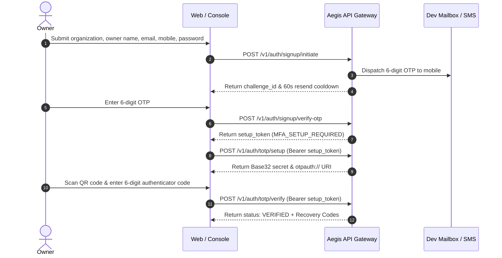

# Project Aegis: Application Usage & Data Contract Guide

This guide explains what Project Aegis does, how to configure access, how to send transactions, and exactly how data is structured and processed.

---

## 1. What Aegis Is

Project Aegis is a real-time transaction decision engine and audit platform for payment companies, banks, and merchants. When a customer attempts a purchase, the payment gateway sends the transaction details to Aegis over HTTP. Aegis evaluates risk criteria within milliseconds and returns one of three outcomes:
- **`APPROVE`**: Transaction appears safe; allow the payment to proceed.
- **`REVIEW`**: Transaction flags high-risk anomalies; hold for human review or challenge via step-up authentication.
- **`DECLINE`**: Transaction violates strict fraud limits; reject the payment immediately.

### Who Uses It?
- **Merchants & Payment Processors:** Call the ingestion API (`POST /v1/decisions`) synchronously during payment checkout.
- **Risk Analysts & Fraud Managers:** Monitor transactions on the live console, inspect fired rules, and handle manual review queues.
- **Rule Authors & Developers:** Configure fraud thresholds, run historical replay simulations, and integrate webhooks.
- **Auditors & Compliance Officers:** Verify cryptographic audit trails and multi-tenant access logs.

---

## 2. Roles & Permissions

Aegis defines seven canonical roles within each tenant organization. The table below lists each role and what actions it can perform in the application today:

| Role | Intended Responsibility | Actual Capabilities in Application Today |
| :--- | :--- | :--- |
| **`owner`** | Organization founder / executive head. | Full access: invite new members, change tenant settings, initiate signups, view live decisions feed, invoke decision APIs. |
| **`admin`** | Technical administrator. | Invite teammates, manage user accounts, access live decisions console, invoke decision APIs. |
| **`risk_manager`** | Head of fraud and risk policy. | View live decisions console, access `/rules` and `/cases` routes (currently placeholders), invoke decision APIs. |
| **`rule_author`** | Risk engineer / data analyst writing rules. | View live decisions console, access `/rules` route (currently placeholder), invoke decision APIs. |
| **`risk_analyst`** | Tier 1/2 operator investigating alerts. | View live decisions console, access `/cases` route (currently placeholder), invoke decision APIs. |
| **`auditor`** | External or internal compliance inspector. | View live decisions console, access `/audit` route (currently placeholder), read-only audit log inspection. |
| **`developer`** | API integration engineer. | Default role assigned under local dev-header authentication mode; invoke decision APIs and inspect live streams. |

---

## 3. Getting Started: Onboarding & Authentication

### 3.1 Initial Owner Signup Flow

User registration requires completing three sequential verification stages:



#### Form Validation Rules:
- **`organization_name`**: String, required, 2 to 100 characters.
- **`owner_name`**: String, required, 2 to 100 characters.
- **`email`**: Valid RFC 5322 email string, case-insensitive unique in system.
- **`mobile`**: E.164 international format (e.g. `+919811223344`), unique in system.
- **`password`**: Minimum 12 characters, must contain at least one uppercase letter, one lowercase letter, one number, and one symbol.
- **OTP Verification**: 6 decimal digits. Lifetime: **5 minutes**. Rate limit: **3 signup attempts per hour per IP**.
- **Local Dev Mailbox**: In local development (`tier0`), open `http://localhost:5173/dev/mailbox` or `http://localhost:8080/dev/mailbox` to view generated OTPs without SMS hardware.

### 3.2 Login with Multi-Factor Authentication (MFA)
1. **Primary Authentication (`POST /v1/auth/login`)**:
   - Provide `identifier` (email or mobile) and `password`.
   - Returns `{ "mfa_required": true, "mfa_token": "..." }`.
   - The `mfa_token` is a short-lived token valid for **5 minutes**, restricted solely to the MFA challenge endpoint.
2. **TOTP Verification (`POST /v1/auth/totp/challenge`)**:
   - Submit `mfa_token` and current 6-digit `totp_code` from your authenticator app (Google Authenticator, Authy, 1Password), or a 10-character `recovery_code`.
   - On success, the API returns a **15-minute RS256 Bearer access token** in the response body and sets an **HTTP-only, SameSite=Strict `jwt_refresh_token` cookie**.

### 3.3 Inviting Team Members
An authenticated `owner` or `admin` can invite colleagues:
- **Endpoint:** `POST /v1/tenant/invites`
- **Payload:**
  ```json
  {
    "email": "analyst@yourcompany.com",
    "role": "risk_analyst"
  }
  ```
- Generates an invite link valid for **7 days**. The invitee opens the link, sets their password and mobile number, configures TOTP 2FA, and joins the tenant.

---

## 4. Sending Transactions: `POST /v1/decisions`

### 4.1 Ingestion Schema Data Contract

Transactions must be posted as JSON to `POST /v1/decisions`. Every request requires an authentication token and an `X-Tenant-Id` header matching the tenant.

| Field Name | JSON Type | Required? | Constraints & Format | Description |
| :--- | :--- | :--- | :--- | :--- |
| **`event_id`** | `string` | **Yes** | 1 to 64 chars, non-blank (UUID or merchant prefix). | Unique idempotency identifier for the transaction. |
| **`event_time`** | `string` | **Yes** | ISO-8601 UTC date-time (e.g. `2026-11-03T17:00:00Z`). | Transaction timestamp according to event clock. |
| **`sequence_number`**| `integer` | No | $\ge 0$, default `0`. | Monotonic sequence number for strict event-time ordering. |
| **`tenant_id`** | `string` | **Yes** | Valid UUID format. | Tenant identity. In production, must match the JWT claim. |
| **`amount_minor_units`**| `integer` | **Yes** | $\ge 0$ (e.g. paise for INR, cents for USD). | Transaction value. $50,000\text{ INR} = 5,000,000\text{ units}$. |
| **`currency`** | `string` | No | ISO-4217 3-letter code. Default: `"INR"`. | Currency code. |
| **`payment_method`**| `string` | **Yes** | `CARD`, `UPI`, `NETBANKING`, `WALLET`, `BNPL`, `EMI`, `NACH`. | Payment rail used for checkout. |
| **`merchant_id`** | `string` | No | 1 to 64 chars. | Unique merchant terminal or store identifier. |
| **`merchant_category_code`** | `string` | No | 4 numeric digits (ISO 18245 MCC). | Industry category (e.g. `5411` Grocery, `5812` Dining). |
| **`merchant_name`** | `string` | No | 1 to 128 chars. Free of raw card numbers. | Legal trading name of the merchant. |
| **`channel`** | `string` | No | `POS`, `WEB`, `MOBILE_APP`, `API`. | Ingestion origin channel. |
| **`card_token`** | `string` | No | Tokenized card network token (`tok_...`). | **Zero PAN rule:** Never send raw 16-digit card numbers. |
| **`account_id_hash`**| `string` | No | Pseudonymized customer ID hash. | Entity tracking hash for velocity counters. |
| **`upi_vpa_hash`** | `string` | No | Pseudonymized UPI VPA handle hash. | UPI account identifier hash. |
| **`ip_address`** | `string` | No | IPv4 or IPv6 format string. | Customer client IP address. |
| **`device_id`** | `string` | No | Persistent client device fingerprint. | Device tracking identifier. |
| **`user_agent`** | `string` | No | HTTP User-Agent string. | Client browser / OS details. |
| **`custom_fields`** | `object` | No | Map of string key-value pairs (`{"k": "v"}`). | Merchant metadata. Subject to Luhn PAN scanning. |

### 4.2 The Zero PAN Invariant & Luhn Scanner

Aegis is strictly designed to handle tokenized payments (`card_token: tok_...`).
- **Primary Control:** API contracts reject raw card numbers.
- **Secondary Control:** The backend executes `LuhnPanScanner` on `merchant_name` and all values in `custom_fields`. If a 13-to-19 digit number that satisfies the Luhn mod-10 checksum is detected, the request is immediately rejected with:
  ```json
  {
    "type": "urn:problem:pan-prohibited",
    "title": "PAN Prohibited",
    "status": 400,
    "detail": "Primary Account Numbers (PANs) are strictly prohibited in transaction payloads.",
    "instance": "/v1/decisions",
    "invalid_params": [
      {
        "name": "merchant_name",
        "reason": "Raw card numbers (PANs) are strictly prohibited"
      }
    ]
  }
  ```

---

## 5. Verified Transaction Payloads & Engine Responses

The following examples have been executed and verified against the running local Aegis backend.

### Example 1: Standard Retail Purchase (`APPROVE`)

A routine coffee shop transaction under 50,000 INR:

**Request Payload:**
```json
{
  "event_id": "tx_verified_approve_001",
  "event_time": "2026-11-03T17:00:00Z",
  "sequence_number": 1,
  "tenant_id": "00000000-0000-0000-0000-000000000001",
  "card_token": "tok_visa_4242424242424242",
  "amount_minor_units": 35000,
  "currency": "INR",
  "payment_method": "CARD",
  "merchant_id": "merch_starbucks_01",
  "merchant_category_code": "5812",
  "merchant_name": "Starbucks Coffee Bandra",
  "channel": "POS"
}
```

**Real API Response (HTTP 200 OK):**
```json
{
  "decision_id": "62e129db-b383-498b-b465-8c211b928e2c",
  "event_id": "tx_verified_approve_001",
  "outcome": "APPROVE",
  "score": 15.0,
  "hard_rule_fired": false,
  "ruleset_id": "stub-ruleset-v1",
  "ruleset_version_hash": "e3b0c44298fc1c149afbf4c8996fb92427ae41e4649b934ca495991b7852b855",
  "rules_fired": [],
  "degraded": false,
  "degraded_reason": null,
  "latency_ms": 0.003,
  "timestamp": "2026-11-03T17:00:00Z"
}
```

---

### Example 2: High-Value Jewelry Transaction (`REVIEW`)

A jewelry purchase exceeding the 50,000 INR review threshold:

**Request Payload:**
```json
{
  "event_id": "tx_verified_review_002",
  "event_time": "2026-11-03T17:01:00Z",
  "sequence_number": 2,
  "tenant_id": "00000000-0000-0000-0000-000000000001",
  "card_token": "tok_mastercard_5555555555554444",
  "amount_minor_units": 7500000,
  "currency": "INR",
  "payment_method": "CARD",
  "merchant_id": "merch_tanishq_delhi",
  "merchant_category_code": "5944",
  "merchant_name": "Tanishq Jewelers CP",
  "channel": "POS"
}
```

**Real API Response (HTTP 200 OK):**
```json
{
  "decision_id": "0d0c519a-2393-4b83-837c-7a4a7a03d460",
  "event_id": "tx_verified_review_002",
  "outcome": "REVIEW",
  "score": 75.0,
  "hard_rule_fired": true,
  "ruleset_id": "stub-ruleset-v1",
  "ruleset_version_hash": "e3b0c44298fc1c149afbf4c8996fb92427ae41e4649b934ca495991b7852b855",
  "rules_fired": [
    {
      "rule_id": "STUB-HIGH-AMOUNT",
      "name": "Transaction amount exceeds 50,000 INR threshold",
      "score_impact": 75.0,
      "reason_code": "AMOUNT_GE_50K"
    }
  ],
  "degraded": false,
  "degraded_reason": null,
  "latency_ms": 0.006,
  "timestamp": "2026-11-03T17:01:00Z"
}
```

---

### Example 3: Rejection on Hard Rule or Blacklist (`DECLINE`)

> [!NOTE]
> **Engine Reality Note:** The decision engine today uses `StubEvaluationCore.java`, which contains only the high-amount rule triggering `REVIEW`. The CEL rule engine is currently a stub; therefore, **`DECLINE` cannot be triggered by the engine today without code changes**. The payload below represents the schema contract designed for Milestone M2 (stolen token blacklist rule):

**Planned Request Payload for M2 CEL Rule:**
```json
{
  "event_id": "tx_sample_decline_003",
  "event_time": "2026-11-03T17:02:00Z",
  "sequence_number": 3,
  "tenant_id": "00000000-0000-0000-0000-000000000001",
  "card_token": "tok_visa_stolen_hotlist_9999",
  "amount_minor_units": 1000000,
  "currency": "INR",
  "payment_method": "CARD",
  "merchant_id": "merch_unknown_pos",
  "merchant_name": "Electronics Reseller",
  "channel": "POS"
}
```

**Conforming Expected API Response when M2 Ships:**
```json
{
  "decision_id": "9a38f1b2-1029-4d8b-9021-ab9812401928",
  "event_id": "tx_sample_decline_003",
  "outcome": "DECLINE",
  "score": 99.0,
  "hard_rule_fired": true,
  "ruleset_id": "cel-ruleset-v2",
  "ruleset_version_hash": "a1b2c3d4e5f60718293a4b5c6d7e8f901234567890abcdef1234567890abcdef",
  "rules_fired": [
    {
      "rule_id": "RULE-TOKEN-BLACKLIST",
      "name": "Card network token present on active stolen blacklist",
      "score_impact": 99.0,
      "reason_code": "HOTLIST_TOKEN_MATCH"
    }
  ],
  "degraded": false,
  "degraded_reason": null,
  "latency_ms": 1.15,
  "timestamp": "2026-11-03T17:02:00Z"
}
```

---

## 6. Understanding Results & Idempotency

### 6.1 What Outcomes Mean
- `APPROVE` (Score 0.0 – 49.9): Low risk. Proceed with payment clearing.
- `REVIEW` (Score 50.0 – 89.9): Elevated risk. Trigger 3D-Secure step-up authentication or route to manual queue.
- `DECLINE` (Score 90.0 – 100.0): Critical risk or hard rule match. Block immediately.

### 6.2 Response Field Dictionary
- `decision_id`: Unique UUID assigned to this evaluated decision record.
- `outcome`: Evaluation verdict (`APPROVE`, `REVIEW`, `DECLINE`).
- `score`: Numeric risk score clamped between $0.0$ and $100.0$.
- `hard_rule_fired`: `true` if an absolute blacklist/threshold rule forced the outcome regardless of machine learning models.
- `ruleset_id` & `ruleset_version_hash`: Identifies the exact immutable rule version evaluated, ensuring deterministic auditability.
- `rules_fired`: List of specific rule IDs and human-readable reasons that contributed to the score.
- `degraded`: `true` if Redis velocity counters or downstream dependencies failed and the engine fell back to fail-open/fail-closed defaults.
- `latency_ms`: Server-side execution latency in milliseconds.

### 6.3 Idempotency Semantics
- **Identical Submission:** If you post the same `event_id` with an identical payload, Aegis does **not** evaluate rules again or broadcast a second SSE event. It returns the previously evaluated decision from `processed_events` with HTTP 200 OK.
- **Payload Hash Mismatch:** If you post an existing `event_id` with different amounts or merchant details, the server throws an idempotency conflict.

---

## 7. The Live Console (`/decisions`)

When logged into the web console (`http://localhost:5173` or `https://app.yourdomain.xyz`):
1. **Live Feed Table:** Automatically connects to the Server-Sent Events stream (`GET /v1/events/stream`). Transactions appear in real time at the top of the table.
2. **Table Columns:**
   - **Status Badge:** Geometric visual indicator with high-contrast text (`APPROVE` in emerald, `REVIEW` in amber, `DECLINE` in rose).
   - **Score:** Numeric risk score ($0.0$ to $100.0$).
   - **Event ID:** Truncated identifier; clicking opens full event details.
   - **Amount:** Formatted currency (e.g. `₹750.00`).
   - **Merchant:** Trading merchant name.
   - **Payment Method & Channel:** Badges for card, UPI, POS, Web.
   - **Latency:** Server processing duration (e.g. `0.8ms`).
3. **Test Transaction Modal:** Click **"Test Transaction"** in the top navigation bar to open a dev modal allowing you to simulate and dispatch synthetic transactions with one click.

---

## 8. Authenticating API Calls with cURL (PowerShell)

### Step 1: Obtain a Bearer Access Token
Log in via the API using your credentials and 2FA code:

```powershell
# 1. Login with primary credentials
$loginBody = @{
    identifier = "admin@yourcompany.com"
    password = "YourSecurePassword123!"
} | ConvertTo-Json

$loginResp = Invoke-RestMethod -Uri "http://localhost:8080/v1/auth/login" `
    -Method Post -Body $loginBody -ContentType "application/json"

# 2. Complete TOTP challenge
$challengeBody = @{
    mfa_token = $loginResp.mfa_token
    totp_code = "123456" # Replace with current code from authenticator app
} | ConvertTo-Json

$authResp = Invoke-RestMethod -Uri "http://localhost:8080/v1/auth/totp/challenge" `
    -Method Post -Body $challengeBody -ContentType "application/json"

$token = $authResp.access_token
Write-Host "Bearer Token: $token"
```

### Step 2: Invoke Decision API
Pass the Bearer token in the `Authorization` header and your tenant UUID in `X-Tenant-Id`:

```powershell
$txPayload = @"
{
  "event_id": "tx_cli_test_01",
  "event_time": "$([System.DateTime]::UtcNow.ToString("yyyy-MM-ddTHH:mm:ssZ"))",
  "sequence_number": 1,
  "tenant_id": "00000000-0000-0000-0000-000000000001",
  "card_token": "tok_visa_4242",
  "amount_minor_units": 15000,
  "currency": "INR",
  "payment_method": "CARD",
  "merchant_id": "merch_cafe_01",
  "merchant_name": "Corner Cafe",
  "channel": "POS"
}
"@

curl.exe -X POST "http://localhost:8080/v1/decisions" `
  -H "Authorization: Bearer $token" `
  -H "X-Tenant-Id: 00000000-0000-0000-0000-000000000001" `
  -H "Content-Type: application/json" `
  -d $txPayload
```

---

## 9. Running the Sample Transaction Script

The repository includes a batch dispatch script that sends 12 varied test scenarios from [`scripts/sample-transactions.json`](file:///c:/dev/aegis/scripts/sample-transactions.json) to your local API and prints the decision results.

### How to Run:
```powershell
# Run against local backend (reads token from scratch\token.txt automatically if present)
.\scripts\send-sample-transactions.ps1

# Or explicitly pass token and target URL
.\scripts\send-sample-transactions.ps1 -BaseUrl "http://localhost:8080" -TenantId "00000000-0000-0000-0000-000000000001" -Token "eyJhbGciOi..."
```

### Output Preview:
```text
================================================================================
  Batch Dispatch Summary
================================================================================

Case EventId       AmountINR Expected            Actual   Score LatencyMs RulesFired     
---- -------       --------- --------            ------   ----- --------- ----------     
   1 tx-sample-001       350 APPROVE             APPROVE   15.0     0.003 (none)         
   2 tx-sample-002     75000 REVIEW              REVIEW    75.0     0.006 STUB-HIGH-AM...
   3 tx-sample-003      1250 APPROVE             APPROVE   15.0     0.002 (none)         
   4 tx-sample-004     32990 APPROVE             APPROVE   15.0     0.001 (none)         
   5 tx-sample-001       350 APPROVE (Cached)    APPROVE   15.0       0.0 (none)         
   6 tx-sample-005    150000 REVIEW              REVIEW    75.0     0.002 STUB-HIGH-AM...
   7 tx-sample-006       450 APPROVE             APPROVE   15.0     0.002 (none)         
   8 tx-sample-007       100 APPROVE             APPROVE   15.0     0.001 (none)         
   9 tx-sample-008       100 APPROVE             APPROVE   15.0     0.002 (none)         
  10 tx-sample-009       100 APPROVE             APPROVE   15.0     0.003 (none)         
  11 tx-sample-010       890 APPROVE             APPROVE   15.0     0.001 (none)         
  12 tx-sample-011       500 HTTP 400 Bad Req    HTTP 400     -     38.42 urn:problem:...
```

---

## 10. Data Storage & Security Invariants

| Category | Data Fields | Storage Security & Encryption |
| :--- | :--- | :--- |
| **Passwords** | User authentication passwords. | **Argon2id** hashed ($m=65536, t=3, p=1$) with a unique 16-byte random salt. |
| **TOTP Secrets** | 2FA authenticator shared keys. | **AES-256-GCM** encrypted at rest with tenant-isolated Initialization Vectors (IVs) in `aegis_auth.user_totp_secrets`. |
| **Recovery Codes** | Emergency 10-char account codes. | **Argon2id** hashed in database; plain codes are displayed once to the user and never stored. |
| **Sessions & Refresh Tokens** | Refresh token family strings. | **SHA-256** hashed in `aegis_auth.user_sessions`. |
| **Transactions & Decisions** | Amounts, merchant names, currencies, outcome scores. | Stored in PostgreSQL `decisions` partitioned by month (`decisions_y2026m11`) protected by Row-Level Security (`SET LOCAL app.current_tenant_id`). |
| **Card Numbers (PANs)** | 16-digit debit/credit card numbers. | **NEVER STORED.** The application refuses raw card numbers. Only tokenized representations (`card_token: tok_...`) are persisted. |

---

## 11. What Does Not Work Yet (Placeholders)

To avoid confusion when navigating the application:
1. **Rule Authoring UI (`/rules`):** Displays a "Coming soon" notice. You cannot currently write CEL rules in the console.
2. **Case Management Queue (`/cases`):** Displays a "Coming soon" notice. Transactions marked `REVIEW` do not yet populate a collaborative resolution queue.
3. **Replay & Backtesting (`/replay`):** The replay engine backend is unbuilt. You cannot yet upload historical CSVs to simulate rule changes.
4. **Audit Log Verifier (`/audit`):** Displays a "Coming soon" notice. Merkle root verification is not yet wired to a frontend UI.
5. **Tenant Settings (`/settings` & `/settings/members`):** Displays a "Coming soon" notice. Member invitation is currently performed via direct API call.

---

## 12. Frequently Asked Questions (FAQ)

**Q: Can I process real Visa or Mastercard transactions today?**  
A: No. Aegis is a fraud decision engine, not a payment gateway. You pass transaction metadata received from your payment gateway (e.g. Stripe, Razorpay, Adyen) to Aegis to determine whether to authorize or capture the payment.

**Q: Why does the engine only return `APPROVE` or `REVIEW`?**  
A: The decision engine currently runs `StubEvaluationCore.java`, which checks only whether the transaction amount is $\ge 50,000\text{ INR}$. Milestone M2 will introduce the CEL rule engine to enable user-defined `DECLINE` rules.

**Q: How do I test without sending real SMS messages?**  
A: In local development (`tier0`), all OTPs and invite links are routed to the Dev Mailbox. Navigate to `http://localhost:5173/dev/mailbox` or call `GET http://localhost:8080/dev/mailbox`.

**Q: What happens if I send a transaction with a duplicate `event_id`?**  
A: Aegis guarantees idempotency. If the payload is identical, it returns the cached decision instantly ($< 0.05\text{ ms}$) without re-evaluating rules or duplicating audit entries. If the payload differs, it rejects the request as an idempotency conflict.

**Q: How does multi-tenancy work?**  
A: Every database table (`decisions`, `processed_events`, `outbox`, `users`) enforces PostgreSQL Row-Level Security (RLS). Every transaction query sets `SET LOCAL app.current_tenant_id = '...'`. It is impossible for Tenant A to query or overwrite Tenant B's data.

