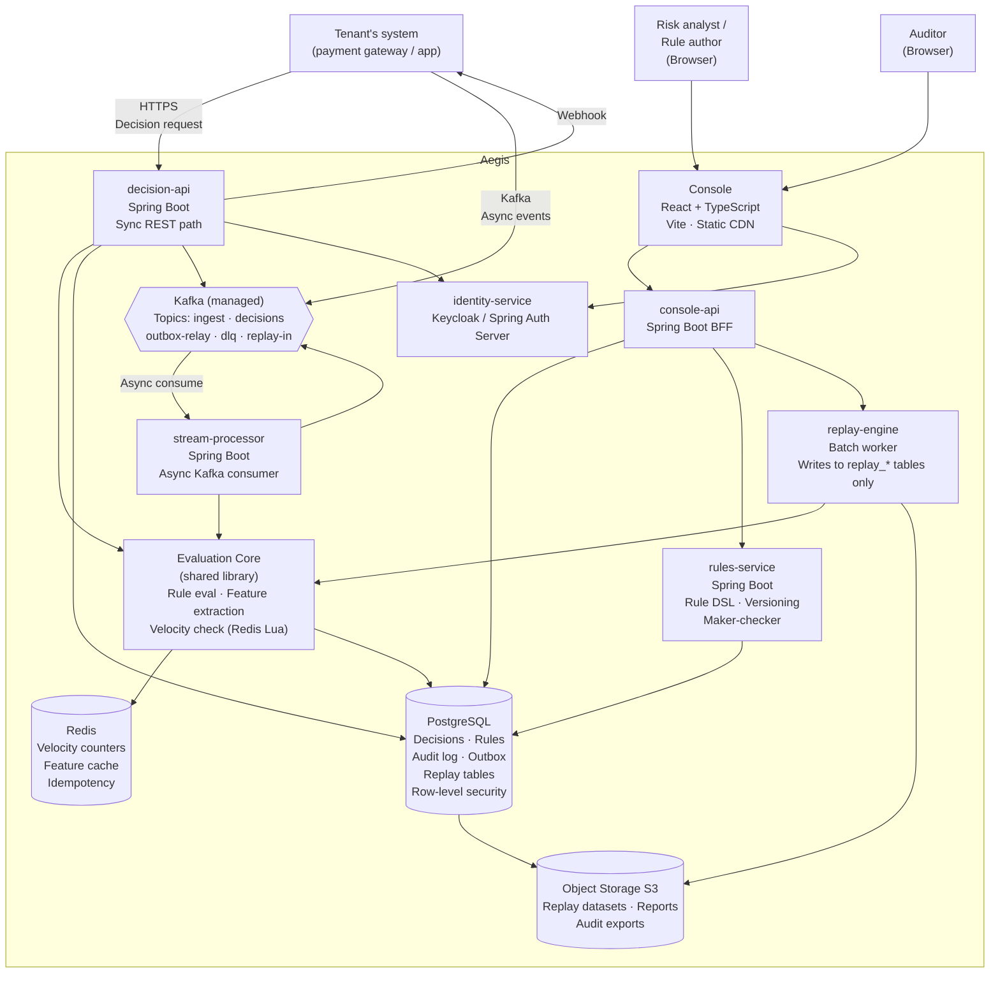

# Architecture Overview

**Document:** 05  
**Status:** Draft  
**Owner:** Founder / Lead Architect (Decision [DR-DOC-01](file:///c:/dev/aegis/docs/00-decisions/decision-register.md))  
**Last updated:** October 2026

---

## 1. Purpose

This document describes the Aegis architecture at C4 levels 1 and 2:
the system in its environment and the major containers inside it.
Lower levels (components, code) are documented per service as they are built.

All decisions that required a meaningful trade-off are recorded in the ADR log
(`docs/adr/`). This document describes what was decided; the ADRs explain why.

---

## 2. Design principles

1. **One evaluation core.** The synchronous API, the async Kafka consumer,
   and the replay engine all call the same evaluation code. This is the
   only guarantee that a replay result means anything.

2. **Modular monolith first.** Six deployables, not 30 microservices.
   Split only when team size or measured scale forces it. See ADR-0001.

3. **Durable write before response.** The decision is committed to Postgres
   before the caller receives an answer. The audit trail is never incomplete.
   See ADR-0002.

4. **Event time everywhere.** The replay engine uses event timestamps, not
   wall-clock time. Velocity features are computed over event-time windows.
   This is what makes replay deterministic. See ADR-0003.

5. **Multi-tenancy is a row-level property, present in every table, every
   Kafka topic key, and every Redis key from day one.** It is not added later.

6. **Fail policy is a tenant configuration, not a system default.** Each
   tenant specifies fail-open or fail-closed. The system has no global
   default.

---

## 3. C4 Level 1 — System Context

Aegis sits between a client system (payment gateway, lending platform, etc.)
and its downstream payment processor or outcome system.

```
External systems and people:

  ┌──────────────────────────────────────────────────────────┐
  │  TENANT'S SYSTEM                                         │
  │  (payment gateway, BNPL app, wallet, marketplace, etc.)  │
  └────────────┬─────────────────────────────────────────────┘
               │ HTTPS — Decision request
               │ Webhook — Decision result (async)
               ▼
  ┌────────────────────────────────────────────────────────────┐
  │                        AEGIS                               │
  │  Real-time transaction decision engine                     │
  │  Returns: approve / decline / review                       │
  │  Explains: every decision, every rule fired                │
  │  Replay: compare two rule versions on historical data      │
  └──────────────────────────────────────────────────────────-─┘
               │
               │ Audit export (daily, S3 Object Lock)
               ▼
  ┌────────────────────────────────────────┐
  │  TENANT'S AUDIT / COMPLIANCE TEAM      │
  │  (Auditor role, read-only console)     │
  └────────────────────────────────────────┘

  ┌────────────────────────────────────────┐
  │  RISK ANALYST / RULE AUTHOR            │
  │  (Console — browser)                   │
  └────────────────────────────────────────┘

  ┌────────────────────────────────────────┐
  │  IDENTITY PROVIDER                     │
  │  (Keycloak or Spring Authorization     │
  │   Server; manages tokens, MFA, SSO)    │
  └────────────────────────────────────────┘
```

---

## 4. C4 Level 2 — Containers

Six deployable units. Each unit is a separate JVM process (or static
build for the console). They share a Postgres cluster, a Redis cluster,
and a Kafka cluster, all of which are managed services in Stage 1.

```
┌─────────────────────────────────────────────────────────────────────────┐
│  AEGIS (deployable containers)                                          │
│                                                                         │
│  ┌─────────────────────┐     ┌────────────────────────────────────┐    │
│  │  decision-api        │     │  stream-processor                  │    │
│  │  Spring Boot / Java  │     │  Spring Boot / Java                │    │
│  │  REST + gRPC         │     │  Kafka consumer, same eval core     │    │
│  │  Sync decision path  │     │  Async ingest path                 │    │
│  └────────┬────────────┘     └──────────────┬─────────────────────┘    │
│           │                                  │                           │
│           └────────────┬─────────────────────┘                          │
│                        │  calls                                          │
│                        ▼                                                 │
│           ┌──────────────────────────────┐                              │
│           │  Evaluation Core (library)   │                              │
│           │  Rule loading + caching      │                              │
│           │  Feature extraction          │                              │
│           │  Velocity check (Redis Lua)  │                              │
│           │  Rule evaluation             │                              │
│           │  Decision assembly           │                              │
│           └──────────────────────────────┘                              │
│                        │                                                 │
│           ┌────────────┤                                                 │
│           │            │                                                 │
│           ▼            ▼                                                 │
│  ┌──────────────┐  ┌──────────────────────────────────────┐            │
│  │  Redis       │  │  PostgreSQL (managed, multi-AZ)       │            │
│  │  Velocity    │  │  Decisions, rules, audit log,         │            │
│  │  counters,   │  │  processed-events, outbox,            │            │
│  │  feature     │  │  replay tables                        │            │
│  │  cache,      │  │  Row-level security per tenant        │            │
│  │  idempotency │  └──────────────────────────────────────┘            │
│  └──────────────┘                                                       │
│                                                                         │
│  ┌──────────────────────────────────────────────────────────────────┐  │
│  │  Kafka (managed)                                                 │  │
│  │  Topics: ingest · decisions · outbox-relay · dlq · replay-in    │  │
│  │  Schema registry enforces Avro schemas per topic                 │  │
│  └──────────────────────────────────────────────────────────────────┘  │
│                                                                         │
│  ┌─────────────────────┐     ┌─────────────────────────────────────┐   │
│  │  rules-service       │     │  replay-engine (batch worker)       │   │
│  │  Spring Boot / Java  │     │  Spring Boot / Java                 │   │
│  │  Rule DSL parsing,   │     │  Reads replay-in topic or S3        │   │
│  │  versioning,         │     │  Same evaluation core               │   │
│  │  maker-checker API   │     │  Writes only to replay_* tables     │   │
│  └─────────────────────┘     │  Keyed by run_id                    │   │
│                               └─────────────────────────────────────┘  │
│                                                                         │
│  ┌─────────────────────┐     ┌─────────────────────────────────────┐   │
│  │  console-api         │     │  identity-service                   │   │
│  │  Spring Boot / Java  │     │  Keycloak or Spring Auth Server     │   │
│  │  BFF for the React   │     │  Tokens, MFA, invite flows,         │   │
│  │  console             │     │  role claims, session management    │   │
│  └─────────────────────┘     └─────────────────────────────────────┘  │
│                                                                         │
│  ┌─────────────────────────────────────────────────────────────────┐   │
│  │  console (React + TypeScript, Vite)                             │   │
│  │  Static build served via CDN                                    │   │
│  │  Screens: live decisions, transaction detail, case queue,       │   │
│  │  rule editor, replay compare, audit explorer, team settings     │   │
│  └─────────────────────────────────────────────────────────────────┘  │
│                                                                         │
│  ┌─────────────────────────────────────────────────────────────────┐   │
│  │  Object Storage (S3 with Object Lock)                           │   │
│  │  Replay datasets, replay reports, audit exports, WAL archives   │   │
│  └─────────────────────────────────────────────────────────────────┘  │
└─────────────────────────────────────────────────────────────────────────┘
```

---

## 5. Mermaid Diagram — Container View



---

## 6. Key Data Flows

### 6.1 Synchronous decision (happy path)

1. Caller authenticates (OAuth2 client credentials or API key + HMAC).
2. `decision-api` validates the idempotency key and payload hash against
   the idempotency cache (Redis). If already seen with same hash → return
   stored decision immediately.
3. Evaluation Core loads the tenant's active ruleset (in-process cache,
   reloaded on version change).
4. Evaluation Core fetches velocity features from Redis (Lua script:
   atomic trim-window → count → compare → increment in one step).
5. Rule evaluation runs in-process against the event payload and features.
6. Decision is assembled: outcome, score, rules fired, contributions,
   ruleset hash, latency.
7. Decision is written to Postgres inside a transaction that also inserts
   the `processed_events` row (unique constraint on `tenant_id, event_id`).
   See ADR-0002.
8. Outbox row is inserted in the same transaction.
9. HTTP 200 is returned to the caller with the decision.
10. A background outbox relay reads the outbox and publishes to the
    `decisions` Kafka topic.

### 6.2 Asynchronous decision (Kafka path)

Steps 1 and 2 differ: the consumer receives the event from the `ingest`
topic. Kafka key is `tenant_id:account_id`, which ensures ordering per
entity. Steps 3–10 are identical to the sync path.

### 6.3 Velocity limit — concurrency safety

The critical section in step 4 is an atomic Redis Lua script. Members of
the sorted set are keyed by `event_id`; scores are `event_time` in milliseconds.

The script performs:
```
1. Trim members with score < (event_time - window_ms)
2. If event_id already in set → return {verdict: pass, duplicate: true}   (idempotent)
3. count = ZCARD key
4. If count ≥ limit → return {verdict: fail, duplicate: false}
5. ZADD key event_time event_id
6. Return {verdict: pass, duplicate: false}
```

Because Redis executes Lua scripts serially, two concurrent callers cannot
both see a count below the limit. Because `event_id` is the member, a
duplicate event is detected in step 2 and does not increment the counter.

Redis hash tags (`{tenant_id:account_id}`) pin the key to one cluster slot,
which is required for Lua atomicity across cluster nodes.

Postgres is the source of truth. A reconciliation job runs every 5 minutes
and rebuilds velocity counters from the decisions table. If Redis drift
exceeds a threshold, an alert fires. See ADR-0005.

### 6.4 Duplicate delivery protection

Two layers are in effect on the async Kafka consumer path:

1. **Idempotency cache pre-check (fast path).** Before invoking the Lua
   velocity script, the consumer checks the Redis idempotency cache keyed
   by `(tenant_id, event_id)`. A cache hit returns the stored decision
   immediately without touching velocity counters or the database.

2. **Lua script membership check (second layer).** If the cache has expired
   or the consumer was restarted, the Lua script's `event_id` sorted-set
   membership check catches the duplicate before incrementing the counter
   (see §6.3 step 2).

3. **Postgres unique constraint (authoritative layer).** The `processed_events`
   table has a unique constraint on `(tenant_id, event_id)`. This row is
   inserted in the **same database transaction** as the decision row. If
   both cache and Lua checks are bypassed (e.g., an extreme Redis failure),
   the database constraint prevents a duplicate decision row. The transaction
   rolls back; the consumer commits the offset without writing a duplicate.

See ADR-0005 for the full design rationale.

### 6.5 Replay run

1. Initiator (Risk Manager) selects ruleset A, ruleset B, a dataset
   (historical S3 object or a date range from the decisions table), and
   optionally a label column.
2. `replay-engine` is started with a `run_id`.
3. Events are read in `(event_time, sequence)` order. See ADR-0003.
4. For each event, the evaluation core is called with the event's timestamp
   as the clock (not wall clock). Velocity windows use in-memory windowed
   state (`InMemoryVelocityWindow`), not Redis — replay has no Redis
   dependency. See ADR-0005.
5. Results are written exclusively to `replay_decisions` and
   `replay_events` tables, keyed by `run_id`. No live table is written.
6. The same `run_id` can be re-submitted; the engine checks for existing
   results and is idempotent on `(run_id, transaction_id)`.
7. On completion, a report is generated: changed decisions, false-positive
   rate, recall, and p50/p95/p99 evaluation latency per ruleset.

---

## 7. Failure Modes

| Component fails | Effect | Recovery |
|-----------------|--------|---------|
| Redis primary | Velocity check falls back to Postgres count (slower); if budget exceeded, fail policy applies | Redis replica promotes; reconciliation job corrects counters |
| Postgres primary | Decision cannot be committed; API returns 503; async consumer pauses | Postgres failover (~30 s); no decisions are lost (consumer re-processes from last committed offset) |
| Kafka broker (one of three) | No effect (replication factor 3) | Automatic partition leader election |
| All Kafka brokers | Async ingest stops; sync path continues | Restore Kafka; consumers re-read from last offset |
| `decision-api` instance | Load balancer routes to healthy instances | Horizontal scaling; auto-replace unhealthy pod |
| Evaluation Core OOM | Pod restarts; in-flight requests fail | Return 503; caller retries with idempotency key |

Every failure path for the sync API eventually applies the tenant's fail policy
(fail-open or fail-closed) with a `degraded: true` flag in the decision.

---

## 8. What is not in this document

- Component-level design (Spring beans, repositories, service classes)
- OpenAPI spec (doc 06, not yet written)
- Data model (doc 07, not yet written)
- Threat model (doc 08, not yet written)
- Rule DSL syntax (doc 09, not yet written)
- Deployment and IaC (doc 14, not yet written)
