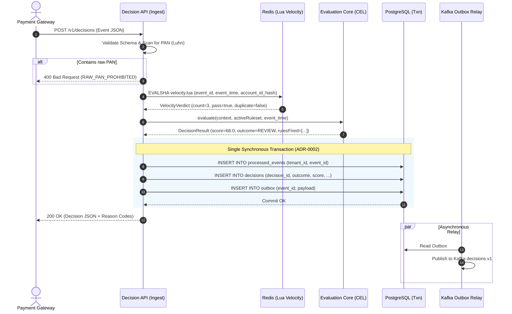
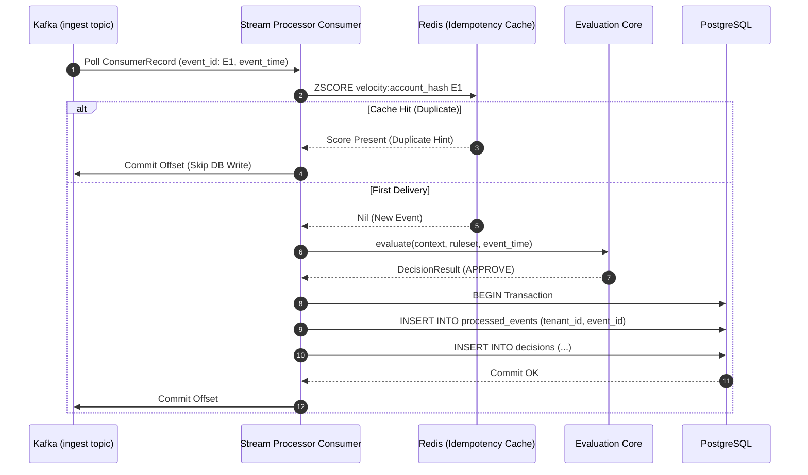
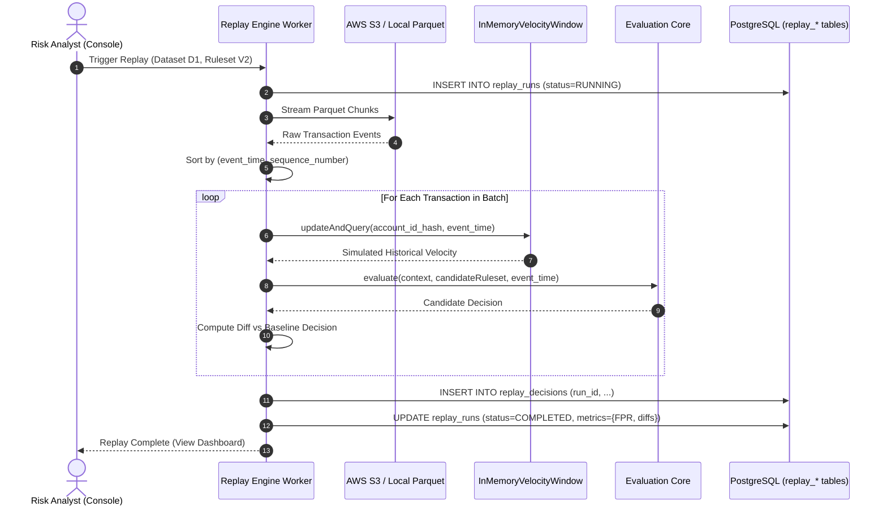
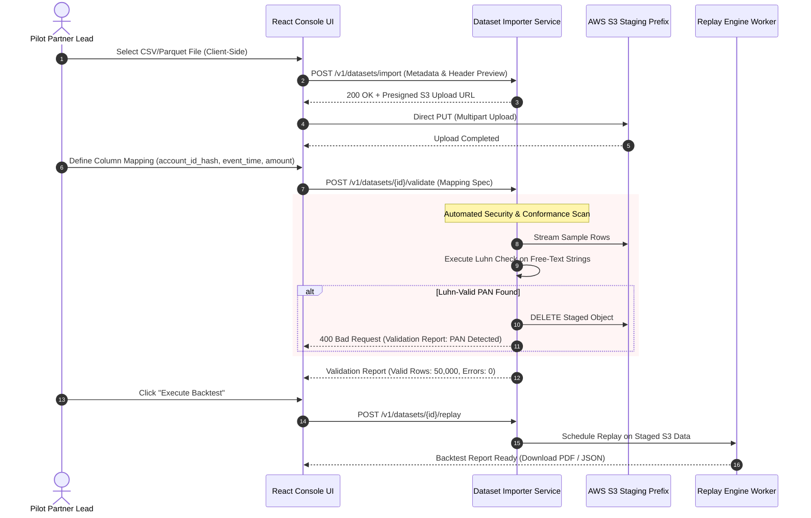

# Backend Architecture and Subsystem Design

**Document:** 17  
**Status:** Approved (docs v1.0, assumption-based)
**Owner:** Founder / Lead Architect ([DR-DOC-01](file:///c:/dev/aegis/docs/00-decisions/decision-register.md))  
**Last updated:** October 2026  

---

## 1. Purpose and Engineering Principles

This document establishes the internal architecture, module layout, interfaces, error contracts, and sequence flows for the Project Aegis backend. The backend is implemented in **Java 21 and Spring Boot 3.3+**, with PostgreSQL 16 as the authoritative store, Redis 7 for sliding-window velocity state, and Apache Kafka 3.7+ for asynchronous streaming.

Consistent with **ADR-0001 (Modular Monolith First)**, **ADR-0006 (Deployment Tiers)**, and **Decision D7**, the backend is engineered as a set of decoupled, strongly bounded modules running inside a single unified Spring Boot application process for Tier 0 (developer laptop) and Tier 1 (pilot shadow mode), with a clean split path to discrete microservices for Tier 2 enterprise deployments.

### 1.1 Core Engineering Invariants
1. **Zero I/O in the Core:** The `aegis-core` module contains purely deterministic rule evaluation logic, AST parsing, and score clamping. It has zero Spring dependencies, zero database access, and zero network calls.
2. **Explicit Time Injection:** The system clock is never invoked directly inside evaluation logic. Time is always passed explicitly as an `Instant eventTime` parameter ([ADR-0003](file:///c:/dev/aegis/docs/adr/0003-event-time-for-deterministic-replay.md), [AGENTS.md](file:///c:/dev/aegis/AGENTS.md)).
3. **Transactional Decision Writes:** A decision row, its deduplication marker (`processed_events`), and its Kafka outbox row are committed synchronously to PostgreSQL in the identical database transaction before the HTTP response is returned to the caller ([ADR-0002](file:///c:/dev/aegis/docs/adr/0002-durable-decision-write-before-response.md)).

---

## 2. Gradle Multi-Module Layout

The repository is structured as a Gradle multi-module project where dependencies flow strictly downward:

```
                          ┌──────────────────────────┐
                          │        aegis-app         │ (Executable Runner: Tier 0 & 1)
                          └─────────────┬────────────┘
                                        │
         ┌───────────────┬──────────────┼──────────────┬──────────────┐
         ▼               ▼              ▼              ▼              ▼
  ┌─────────────┐ ┌─────────────┐ ┌───────────┐ ┌─────────────┐ ┌──────────────┐
  │aegis-ingest │ │aegis-stream │ │aegis-auth │ │aegis-replay │ │ aegis-import │
  └──────┬──────┘ └──────┬──────┘ └─────┬─────┘ └──────┬──────┘ └──────┬───────┘
         │               │              │              │               │
         └───────────────┼──────────────┴──────────────┼───────────────┘
                         ▼                             ▼
                  ┌─────────────┐               ┌─────────────┐
                  │aegis-storage│               │aegis-velocity│
                  └──────┬──────┘               └──────┬──────┘
                         │                             │
                         └──────────────┬──────────────┘
                                        ▼
                                 ┌─────────────┐
                                 │ aegis-core  │ (Pure Domain: Zero I/O)
                                 └─────────────┘
```

| Module Name | Responsibilities | Key Dependencies | Framework Coupling |
|---|---|---|---|
| **`aegis-core`** | Domain models (`EventContext`, `Decision`, `Rule`), Google CEL parser, AST validation, score calculation, reason code generation. | Google CEL-Java (`cel-core`), Jackson annotations. | **Zero Spring / Zero I/O** |
| **`aegis-velocity`** | Sliding-window velocity counters, Redis Lua script loader, in-memory velocity window for replay. | Jedis / Lettuce, Redis Lua scripts. | Spring Data Redis |
| **`aegis-storage`** | PostgreSQL entities, Spring Data JDBC / jOOQ repositories, RLS session interceptors, Flyway migration scripts. | PostgreSQL JDBC, HikariCP, Flyway, jOOQ. | Spring Data JDBC / Tx |
| **`aegis-ingest`** | Synchronous Decision API controller (`POST /v1/decisions`), OpenAPI contracts, PAN filters. | Spring Web, Spring Validation. | Spring Web MVC |
| **`aegis-stream`** | Kafka consumers, transactional outbox Debezium / polling relay, Dead-Letter Queue (DLQ) workers. | Spring Kafka, Kafka Clients. | Spring Kafka |
| **`aegis-replay`** | Deterministic batch replay worker, S3 Parquet / CSV reader, diff engine, confusion matrix calculator. | Apache Parquet, Apache Arrow, AWS S3 SDK. | Spring Batch / Virtual Threads |
| **`aegis-import`** | Dataset import parser, interactive schema mapper, validation analyzer, automated PAN scanner (Decision D8, ADR-0008). | Commons-CSV, DuckDB / Parquet reader, AWS S3 SDK. | Spring Web / Tx |
| **`aegis-sealer`** | Background Merkle tree batch sealer daemon, SHA-256 tree builder, S3 Object Lock anchor publisher (ADR-0004). | AWS S3 SDK, BouncyCastle (SHA-256). | Spring Scheduling |
| **`aegis-identity`**| In-house authentication, JWT provider, TOTP generator, Argon2id hasher, dev mailbox logger (Decision D4, ADR-0007). | Spring Security, Nimbus-Jose-JWT, Argon2-jvm, Totp. | Spring Security |
| **`aegis-app`** | Main Spring Boot application runner, profile configurations (`tier0`, `tier1`, `tier2`), actuator metrics. | All modules above. | Spring Boot Starter |

---

## 3. Package Structure Conventions

All modules follow standard Java naming conventions under the root namespace `in.projectaegis`:

```text
in.projectaegis
├── core
│   ├── model          # Immutable domain records (EventContext, RuleVerdict, Decision)
│   ├── ast            # CEL AST compilation and validation rules
│   ├── evaluator      # EvaluationCore implementation
│   └── explain        # Explainability and contribution calculators
├── velocity
│   ├── redis          # Redis Lua script executors and cluster routing
│   └── memory         # InMemoryVelocityWindow for replay simulation
├── storage
│   ├── entity         # Relational entity definitions mapping to Doc 07 tables
│   ├── repository     # DecisionRepository, RulesetRepository, AuditRepository
│   └── rls            # PostgreSQL session tenant interceptor (SET LOCAL aegis.current_tenant)
├── ingest
│   ├── controller     # DecisionApiController, HealthController
│   ├── filter         # PanScannerFilter, ApiKeyAuthFilter
│   └── dto            # Request/Response DTOs mapping to Doc 06 OpenAPI spec
├── stream
│   ├── consumer       # IngestKafkaConsumer, ShadowConsumer
│   └── outbox         # OutboxEventPublisher
├── replay
│   ├── engine         # ReplayExecutionService, EventTimeSorter
│   └── reader         # ParquetDatasetReader, CsvDatasetReader
├── importer
│   ├── service        # DatasetImportService, MappingEngine
│   └── validator      # SchemaValidator, PanScanValidator
├── sealer
│   ├── daemon         # AuditBatchSealerScheduler
│   └── merkle         # MerkleTreeBuilder, MerkleProofGenerator
└── identity
    ├── service        # InHouseUserDetailsService, InviteTokenService
    ├── totp           # TotpService (RFC 6238)
    └── provider       # DevMailboxNotificationService, SmtpNotificationService
```

---

## 4. Key Interfaces (Java Signatures)

The core architecture is decoupled using explicit interfaces, allowing implementations to be swapped between Tier 0, Tier 1, and Tier 2:

### 4.1 `EvaluationCore`
```java
package in.projectaegis.core.evaluator;

import in.projectaegis.core.model.*;
import java.time.Instant;

/**
 * Pure evaluation engine: zero I/O, zero network calls, zero system clock lookups.
 */
public interface EvaluationCore {
    
    /**
     * Evaluates a payment event against a compiled ruleset at an explicit event time.
     *
     * @param context   The payment features, entity attributes, and custom fields
     * @param ruleset   The active compiled ruleset
     * @param eventTime The explicit occurrence time (never wall-clock)
     * @return Deterministic evaluation result with score, verdict, and explainability breakdown
     */
    DecisionResult evaluate(EventContext context, CompiledRuleset ruleset, Instant eventTime);
}
```

### 4.2 `VelocityStore`
```java
package in.projectaegis.velocity;

import java.time.Duration;
import java.time.Instant;
import java.util.UUID;

public interface VelocityStore {

    /**
     * Atomically executes sliding-window deduplication and increment.
     * Implemented by RedisLuaVelocityStore (production) and InMemoryVelocityWindow (replay).
     */
    VelocityVerdict checkAndIncrement(
        UUID tenantId,
        String entityHash,
        String eventId,
        Instant eventTime,
        long amountMinorUnits,
        Duration windowDuration,
        long countLimit,
        long amountLimit
    );
}
```

### 4.3 `Clock`
```java
package in.projectaegis.core;

import java.time.Instant;

/**
 * Injected clock provider to prevent system clock leakage in tests and replays.
 */
@FunctionalInterface
public interface Clock {
    Instant now();
}
```

### 4.4 `RulesetRepository`
```java
package in.projectaegis.storage.repository;

import in.projectaegis.core.model.CompiledRuleset;
import java.util.Optional;
import java.util.UUID;

public interface RulesetRepository {
    Optional<CompiledRuleset> findActiveByTenant(UUID tenantId);
    UUID saveDraft(UUID tenantId, String dslContent, String authoredBy);
    void approveAndPublish(UUID tenantId, UUID rulesetVersionId, String approvedBy);
}
```

### 4.5 `DecisionRepository`
```java
package in.projectaegis.storage.repository;

import in.projectaegis.core.model.DecisionRecord;
import in.projectaegis.storage.entity.ProcessedEventEntity;
import in.projectaegis.storage.entity.OutboxEntity;

public interface DecisionRepository {
    
    /**
     * Durably writes decision, deduplication marker, and outbox event in ONE database transaction.
     */
    void saveSynchronously(
        DecisionRecord decision,
        ProcessedEventEntity processedEvent,
        OutboxEntity outboxEvent
    );
}
```

### 4.6 `AuditSealer`
```java
package in.projectaegis.sealer;

import in.projectaegis.storage.entity.AuditBatchEntity;
import java.util.List;
import java.util.UUID;

public interface AuditSealer {
    AuditBatchEntity sealBatch(UUID tenantId, List<UUID> unsealedDecisionIds);
    boolean verifyDecisionProof(UUID decisionId);
}
```

### 4.7 `IdentityProvider` ([ADR-0007](file:///c:/dev/aegis/docs/adr/0007-identity-behind-a-port.md))
```java
package in.projectaegis.identity;

import java.util.UUID;

public interface IdentityProvider {
    AuthResult authenticateUser(String email, String rawPassword);
    boolean verifyTotp(UUID userId, String totpCode);
    UserPrincipal validateAccessToken(String jwtToken);
    void issueInvite(UUID tenantId, String email, UserRole role, String invitedBy);
    void triggerPasswordReset(String emailOrMobile);
}
```

### 4.8 `DatasetImporter` ([Decision D8](file:///c:/dev/aegis/docs/00-decisions/assumptions-register.md), [ADR-0008](file:///c:/dev/aegis/docs/adr/0008-dataset-import-for-backtests.md))
```java
package in.projectaegis.importer;

import in.projectaegis.importer.model.*;
import java.io.InputStream;
import java.util.UUID;

public interface DatasetImporter {
    ValidationReport validateAndStage(
        UUID tenantId,
        InputStream fileStream,
        FileFormat format,
        ColumnMapping mapping
    );
    UUID triggerReplay(UUID tenantId, UUID importId, UUID candidateRulesetId);
}
```

---

## 5. Domain Error Model and HTTP Mapping

All exceptions inherit from `AegisDomainException` and serialize to standard **RFC 7807 Problem Details**:

```json
{
  "type": "https://api.aegis.example/v1/errors/raw-pan-prohibited",
  "title": "Raw PAN Prohibited",
  "status": 400,
  "detail": "Field 'merchant_name' contains an unmasked 16-digit card number passing Luhn checksum.",
  "instance": "/v1/decisions",
  "error_code": "RAW_PAN_PROHIBITED",
  "timestamp": "2026-10-22T10:00:00Z"
}
```

| Exception Class | HTTP Status | Error Code | Trigger Condition |
|---|---|---|---|
| `PanViolationException` | 400 Bad Request | `RAW_PAN_PROHIBITED` | Luhn-valid 13–19 digit string detected in request payload. |
| `ClockSkewExceededException` | 400 Bad Request | `CLOCK_SKEW_EXCEEDED` | $\|event\_time - received\_at\| > 300\text{ seconds}$ ([DR-API-03](file:///c:/dev/aegis/docs/00-decisions/decision-register.md)). |
| `DuplicateEventException` | 200 OK (Cache Hit) | `DUPLICATE_EVENT_RETURNED` | Identical `event_id` submitted within 14-day window ([ADR-0005](file:///c:/dev/aegis/docs/adr/0005-velocity-script-event-id-idempotency.md)). |
| `RulesetCompilationException` | 422 Unprocessable | `RULESET_SYNTAX_ERROR` | CEL syntax error, AST node count $> 250$, or ReDoS pattern. |
| `EnrichmentTimeoutException` | 200 OK (Degraded) | `ENRICHMENT_TIMEOUT_DEGRADED`| Downstream Redis timeout; returns fail-open `APPROVE` with degraded flag. |
| `MakerCheckerViolationException` | 403 Forbidden | `MAKER_CHECKER_SELF_APPROVAL` | Rule author attempts to approve or publish own rule draft. |

---

## 6. Profile Configuration Strategy

Spring Boot profiles dictate component wiring across the three deployment tiers (Decision D1, D6):

```yaml
# application.yml
spring:
  profiles:
    active: tier0  # Default local profile

---
# Tier 0: Developer Workstation (RAM Budget <= 3.89 GB)
spring:
  config:
    activate:
      on-profile: tier0
  datasource:
    url: jdbc:postgresql://localhost:5432/aegis_dev
    hikari:
      maximum-pool-size: 5
  data:
    redis:
      host: localhost
      port: 6379
  kafka:
    bootstrap-servers: localhost:9092
aegis:
  identity:
    provider: in-house
    notification: local-mailbox-logger # Writes OTPs and invite links to local stdout / logger
  sealer:
    enabled: true
    interval-seconds: 10
  storage:
    s3-mock: local-filesystem

---
# Tier 1: Pilot Shadow Mode (Single AWS Mumbai ap-south-1 Region)
spring:
  config:
    activate:
      on-profile: tier1
  datasource:
    url: ${DB_JDBC_URL}
    hikari:
      maximum-pool-size: 20
  data:
    redis:
      host: ${REDIS_HOST}
      port: 6379
      ssl: { enabled: true }
aegis:
  identity:
    provider: in-house
    notification: aws-ses-sms
  sealer:
    interval-seconds: 30
    s3-bucket: aegis-audit-anchors-pilot

---
# Tier 2: Multi-AZ Enterprise Production
spring:
  config:
    activate:
      on-profile: tier2
aegis:
  identity:
    provider: keycloak-oidc
```

---

## 7. Database Migration Order (Flyway)

Flyway DDL migrations in `aegis-storage/src/main/resources/db/migration` execute strictly in numerical sequence:

1. `V1__init_tenants_and_roles.sql`: Creates database roles ([doc 07 §2](file:///c:/dev/aegis/docs/07-data-model.md#2-database-roles-and-privilege-matrix)) and `tenants` table.
2. `V2__init_processed_events.sql`: Deduplication table with primary key `(tenant_id, event_id)`.
3. `V3__init_decisions_partitioned.sql`: Monthly partitioned `decisions` table with RLS ([doc 07 §3](file:///c:/dev/aegis/docs/07-data-model.md#3-table-ddl-specifications)).
4. `V4__init_transactional_outbox.sql`: Outbox stream for Kafka event relay.
5. `V5__init_rulesets_and_versions.sql`: Rulesets, immutable versions, and `maker_checker_audit`.
6. `V6__init_audit_batches_and_chains.sql`: `decision_audit_batches`, `audit_chain_heads`, and `audit_management_events`.
7. `V7__init_replay_tables.sql`: `replay_runs` and `replay_decisions` (isolated role permissions).
8. `V8__init_dataset_imports.sql`: `dataset_imports` table for CSV/Parquet uploads ([Decision D8](file:///c:/dev/aegis/docs/00-decisions/assumptions-register.md)).
9. `V9__init_auth_and_sessions.sql`: Users, credentials, TOTP secrets, invites, and sessions ([doc 19](file:///c:/dev/aegis/docs/19-identity-and-auth-spec.md)).

---

## 8. Mermaid Sequence Diagrams

### 8.1 Synchronous Decision API Flow (`POST /v1/decisions`)



---

### 8.2 Asynchronous Kafka Consumer Path (Shadow Mode)



---

### 8.3 Replay Engine Batch Flow



---

### 8.4 Dataset Import and Backtest Flow (Decision D8)


